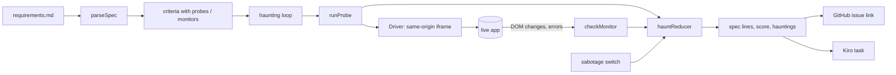

# Design: Specter

## Overview

## Spec language (`src/spec.ts`)
- Criterion: `N.M text`; check line: indented `probe: step; step; …` or `monitor: …`.
- Steps split on `;` outside double quotes; text is quoted with `\"` and `\\` escapes.
- Expressions: recursive descent over `+ - * /`, unary minus, parentheses, names, `round(x)`, `round2(x)`. `formatExpr` is fully parenthesized; `formatExprTop` drops the outermost pair for display. Both round-trip.
- Comparisons: `== != < <= > >=`, with ±0.005 tolerance for equality.

## Runner (`src/runner.ts`)
- `Driver` = `visit()` (reload iframe with a cache-busting query, wait for `data-ready`), `doc()`, `point(el)` (scroll inside the frame, move the ghost cursor), `pace()`.
- Probe steps settle 60 ms after actions. `expect visible` polls every 40 ms up to its limit. `expect hidden` waits, then checks.
- Monitors: sum = Σ `numberIn` of matches, rounded to the cent. `no errors` filters the error log by time window.

## State (`src/haunt.ts`)
Per criterion: `idle | pass | fail | invalid`, last failure, timing, pass/fail counts. Hauntings: `{criterionId, kind, failure, firstSeen, detectedAfterS?, resolvedAt?}`. A reset (spec change) keeps resolved history and drops open hauntings.

## Correctness properties

| # | Property | Requirement |
| --- | --- | --- |
| P1 | `parseExpr(formatExpr(e)) == e` and `parseExpr(formatExprTop(e)) == e` | 1.2 |
| P2 | `evalExpr` equals the equivalent JavaScript | 2.2 |
| P3 | `parseProbe(formatProbe(s)) == s` for any steps, including quotes and `;` in text | 1.2 |
| P4 | `parseMonitor(formatMonitor(m)) == m` | 1.2 |
| P5 | `numberIn` recovers any money-formatted amount; `==` is exactly `!(!=)` | 2.2, 3.1 |
| P6 | Unparseable lines become criterion errors, never exceptions | 1.3 |
| P7 | Failing ⇔ exactly one open haunting, for any action sequence | 4.1, 4.2 |
| P8 | Invalid criteria never pass, fail or haunt | 1.3 |
| P9 | Resolved hauntings stay resolved, never before they were seen | 4.2 |
| P10 | Detection time only within 2 minutes after a sabotage | 4.3 |
| P11 | Issue links round-trip title and body through the URL | 4.4 |
